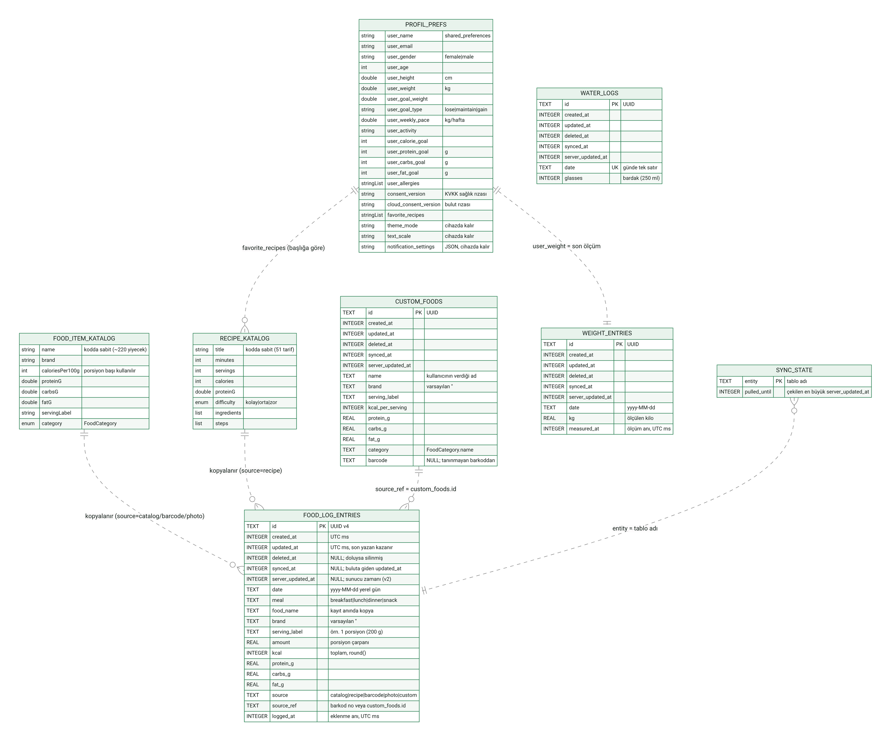
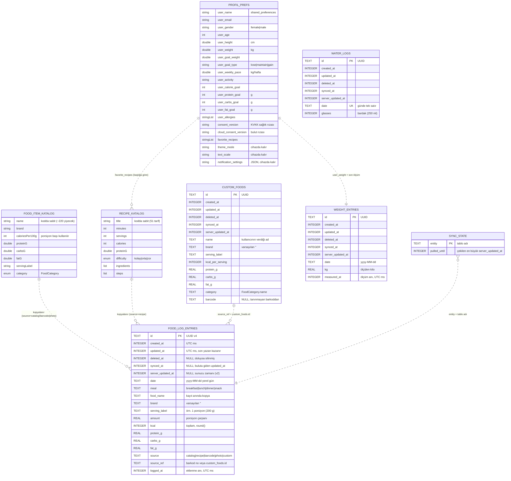
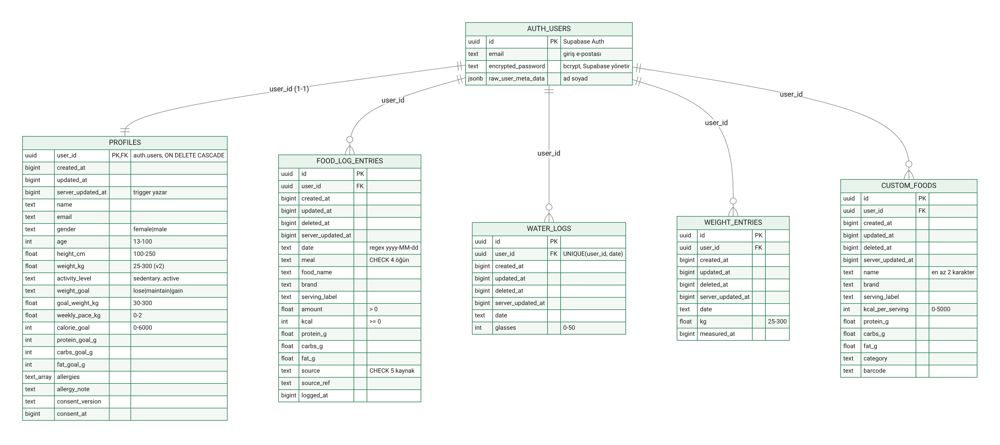
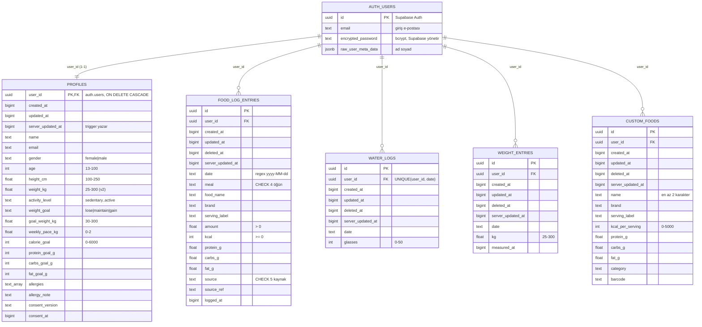

# Denge — ER Diyagramı ve Veritabanı

Bu belge uygulamanın **güncel** veri modelini anlatır (yerel şema v2, bulut şeması
`supabase/migrations/` içindeki iki migration). Kaynaklar: `lib/data/db/tables.dart`,
`lib/data/db/app_database.dart`, `lib/data/app_state.dart`, `supabase/migrations/*.sql`.

Veri üç yerde durur:

| Katman | Teknoloji | Ne tutar | Cihazdan çıkar mı? |
| --- | --- | --- | --- |
| **Yerel veritabanı** | SQLite (`drift`), dosya `denge.sqlite`, şema v2 | Günlük kayıtları, su, kilo, kullanıcının kendi yiyecekleri, senkron imleci | Yalnızca bulut rızası varsa |
| **Ayarlar deposu** | `shared_preferences` (anahtar–değer) | Profil, hedefler, alerjiler, rızalar, tema, yazı boyutu, bildirimler | Profil/hedef/alerji/rıza kısmı rızayla `profiles` tablosuna |
| **Bulut** | Supabase (PostgreSQL + Auth + RLS), AB / Frankfurt | Yerel tabloların hesaba bağlı kopyası + profil | — |
| **Statik katalog** | Dart kodu (`mock_data.dart`, `extra_foods.dart`, `more_foods.dart`, `recipes.dart`) | ~220 yiyecek, 51 tarif | Hayır, değiştirilemez |

Uygulama **her zaman yerel veritabanından okur**; bulut arka planda eşitlenen bir yedektir.

---

## 1. Cihaz tarafı ER diyagramı

Çizgi türleri: kesikli çizgi = mantıksal ilişki (veritabanında yabancı anahtar yok; değer
kopyalanır ya da `id` metin olarak tutulur). `PROFIL_PREFS`, `FOOD_ITEM_KATALOG` ve
`RECIPE_KATALOG` tablo değildir, mantıksal varlık olarak gösterilmiştir.

## 2. Bulut (Supabase) ER diyagramı

Düz çizgi = gerçek yabancı anahtar (`user_id → auth.users.id`, `ON DELETE CASCADE`).
Hesap silinince (`delete_my_account()`) kullanıcıya ait bütün satırlar otomatik silinir.

### Yerel ↔ bulut eşlemesi

| Yerel tablo (SQLite) | Bulut tablosu (Postgres) | Fark |
| --- | --- | --- |
| `food_log_entries` | `public.food_log_entries` | Bulutta `user_id` var, `synced_at` yok |
| `water_logs` | `public.water_logs` | Tekillik yerelde `date`, bulutta `(user_id, date)`; yazma `upsert_water()` RPC'si ile |
| `weight_entries` | `public.weight_entries` | Bulutta `user_id` |
| `custom_foods` | `public.custom_foods` | Bulutta `user_id` |
| `shared_preferences` profil anahtarları | `public.profiles` | Tek satır / kullanıcı, `id` yerine `user_id` PK |
| `sync_state` | — | Yalnızca cihazda; çekme imleci |

---

## 3. Ortak senkron sütunları (`SyncColumns`)

Dört kullanıcı tablosunun hepsi bu sütunları taşır (Drift'te tek bir `mixin`):

| Sütun | Tip | Boş olabilir | Ne tutar |
| --- | --- | --- | --- |
| `id` | TEXT, PK | Hayır | Cihazda üretilen UUID v4. Bulutta da aynı `id` kullanılır |
| `created_at` | INTEGER | Hayır | Satırın oluşturulduğu an, UTC milisaniye |
| `updated_at` | INTEGER | Hayır | Son değişiklik anı, UTC ms. Çakışmada büyük olan kazanır |
| `deleted_at` | INTEGER | Evet | Doluysa satır silinmiş sayılır (yumuşak silme); okuma sorguları `deleted_at IS NULL` ister |
| `synced_at` | INTEGER | Evet | Buluta ulaşan sürümün `updated_at` değeri. `NULL` veya `< updated_at` ise satır gönderilmeyi bekler |
| `server_updated_at` | INTEGER | Evet | Sunucunun koyduğu zaman damgası (v2). Çekme imleci telefon saatine değil buna dayanır |

---

## 4. Veri sözlüğü — yerel veritabanı (`denge.sqlite`, şema v2)

### 4.1 `food_log_entries` — yemek günlüğü
Günlüğe eklenen her yiyecek bir satırdır. Ad, porsiyon, kalori ve makrolar **kayıt anında
kopyalanır**; katalog sonradan değişse de eski günler değişmez.
İndeksler: `food_log_date (date)`, `food_log_date_meal (date, meal)`.

| Sütun | Tip | Ne tutar | Örnek |
| --- | --- | --- | --- |
| *(ortak sütunlar)* | | §3 | |
| `date` | TEXT | Cihazın **yerel** gününe göre gün, `yyyy-MM-dd`. 23:30'da eklenen yemek o güne aittir | `2026-10-14` |
| `meal` | TEXT | Öğün: `breakfast`, `lunch`, `dinner`, `snack` | `breakfast` |
| `food_name` | TEXT | Yiyeceğin adı | `Menemen` |
| `brand` | TEXT | Marka, yoksa boş metin | `''` |
| `serving_label` | TEXT | Bir porsiyonun tarifi | `1 porsiyon (200 g)` |
| `amount` | REAL | Kaç porsiyon (çarpan) | `1.5` |
| `kcal` | INTEGER | `amount` porsiyonun toplam kalorisi, yuvarlanmış | `180` |
| `protein_g` / `carbs_g` / `fat_g` | REAL | Toplam makrolar (gram) | `9.75` |
| `source` | TEXT | Nereden geldi: `catalog`, `recipe`, `barcode`, `photo`, `custom` | `catalog` |
| `source_ref` | TEXT, boş olabilir | `barcode` ise barkod numarası, `custom` ise `custom_foods.id` | `8690504...` |
| `logged_at` | INTEGER | Eklenme anı (UTC ms); gün içi sıralama için | `1792...` |

### 4.2 `water_logs` — su takibi
Her gün için **tek satır** (`date` UNIQUE). Bardağa dokunmak o günün satırını günceller (upsert).
Bir bardak 250 ml, günlük hedef 10 bardak (2,5 L).

| Sütun | Tip | Ne tutar |
| --- | --- | --- |
| *(ortak sütunlar)* | | §3 |
| `date` | TEXT, UNIQUE | Yerel gün, `yyyy-MM-dd` |
| `glasses` | INTEGER | O gün içilen bardak sayısı |

### 4.3 `weight_entries` — kilo geçmişi
Aynı gün birden fazla ölçüm saklanır; grafik her günün **son** ölçümünü kullanır.
Profildeki `user_weight` her zaman son ölçüme eşitlenir.

| Sütun | Tip | Ne tutar |
| --- | --- | --- |
| *(ortak sütunlar)* | | §3 |
| `date` | TEXT | Ölçümün yerel günü |
| `kg` | REAL | Ölçülen kilo |
| `measured_at` | INTEGER | Ölçüm anı, UTC ms (aynı gündeki ölçümleri sıralar) |

### 4.4 `custom_foods` — kullanıcının kendi yiyecekleri
Katalogda olmayan, kullanıcının "Yiyeceği kendin ekle" ile girdiği yiyecekler. Aramada en üstte çıkar.

| Sütun | Tip | Ne tutar |
| --- | --- | --- |
| *(ortak sütunlar)* | | §3 |
| `name` | TEXT | Yiyeceğin adı |
| `brand` | TEXT | Marka, varsayılan boş |
| `serving_label` | TEXT | Porsiyon tarifi (`1 dilim`) |
| `kcal_per_serving` | INTEGER | Bir porsiyonun kalorisi |
| `protein_g` / `carbs_g` / `fat_g` | REAL | Bir porsiyonun makroları |
| `category` | TEXT | `FoodCategory` adı (`kahvaltilik`, `corba`, `tatli` …) |
| `barcode` | TEXT, boş olabilir | Tanınmayan bir barkod taramasından kaydedildiyse barkod; sonraki taramada doğrudan bulunur |

### 4.5 `sync_state` — senkron imleci (v2)
Kullanıcı verisi değil, defter tutma tablosu; senkron sütunları yoktur.

| Sütun | Tip | Ne tutar |
| --- | --- | --- |
| `entity` | TEXT, PK | Senkronlanan tablonun adı (`food_log_entries`, `profiles` …) |
| `pulled_until` | INTEGER | Buluttan çekilmiş en büyük `server_updated_at` |

---

## 5. Veri sözlüğü — `shared_preferences` (anahtar–değer)

| Anahtar | Tip | Ne tutar | Buluta gider mi? |
| --- | --- | --- | --- |
| `setup_complete` | bool | Kurulum sihirbazı bitti mi | Hayır |
| `user_name`, `user_initials`, `user_email` | String | Ad soyad, baş harfler, e-posta | Evet (`profiles.name/email`) |
| `user_gender` | String | `female` / `male` | Evet |
| `user_age` | int | Yaş | Evet |
| `user_height` | double | Boy (cm) | Evet |
| `user_weight` | double | Güncel kilo, son ölçüme eşit | Evet (`weight_kg`) |
| `user_goal_weight` | double | Hedef kilo | Evet |
| `user_goal_type` | String | `lose` / `maintain` / `gain` | Evet (`weight_goal`) |
| `user_weekly_pace` | double | Haftalık tempo (kg) | Evet |
| `user_activity` | String | `sedentary` / `light` / `moderate` / `active` | Evet |
| `user_calorie_goal` | int | Günlük kalori hedefi (Mifflin-St Jeor) | Evet |
| `user_protein_goal`, `user_carbs_goal`, `user_fat_goal` | int | Günlük makro hedefleri (g) | Evet |
| `user_member_since` | String (ISO) | Üyelik başlangıcı | Hayır |
| `user_allergies`, `user_allergy_note` | List / String | Alerjenler (gluten, süt, yumurta, yer fıstığı, sert kabuklu, soya, balık, kabuklu deniz ürünü, susam) ve serbest not | Evet |
| `consent_version`, `consent_at` | String | KVKK sağlık verisi rızasının sürümü ve zamanı | Evet |
| `cloud_consent_version`, `cloud_consent_at` | String | Bulut yedekleme (yurt dışı aktarım) rızası | Hayır |
| `profile_updated_at` | int | Profilin son değişimi; profil senkronunda son yazan kazanır | Hayır |
| `last_synced_at` | String | Son başarılı eşitleme | Hayır |
| `favorite_recipes` | List | Favori tarifler (**başlığa göre**) | Hayır |
| `theme_mode`, `text_scale`, `reduce_motion`, `locale` | String / bool | Görünüm ayarları | Hayır (cihaza özgü) |
| `notification_settings` | String (JSON) | Öğün/su hatırlatıcıları, saatleri, haftalık özet | Hayır (cihaza özgü) |
| `weight_history_migrated` | bool | Eski kilo verisinin veritabanına taşındığı bilgisi | Hayır |

---

## 6. Veri sözlüğü — bulut (Supabase, `public` şeması)

Bütün zaman sütunları yereldeki gibi **UTC milisaniye (`bigint`)**; senkronda dönüşüm yapılmaz.

### 6.1 `auth.users`
Supabase Auth'un kendi tablosu. E-posta, şifre özeti (bcrypt) ve kayıtta girilen ad
(`raw_user_meta_data`). Diğer bütün tablolar `user_id` ile buna bağlanır.

### 6.2 `profiles` — buluttaki profil (kullanıcı başına 1 satır)
| Sütun | Tip | Kısıt | Ne tutar |
| --- | --- | --- | --- |
| `user_id` | uuid, PK, FK | `auth.users`, cascade | Hesap |
| `created_at`, `updated_at` | bigint | | İstemci zamanları |
| `server_updated_at` | bigint | trigger yazar | Sunucu zamanı |
| `name`, `email` | text | | Ad soyad, e-posta |
| `gender` | text | `female`/`male` | Cinsiyet |
| `age` | int | 13–100 | Yaş |
| `height_cm` | float | 100–250 | Boy |
| `weight_kg` | float | 25–300 | Güncel kilo (2. migration) |
| `activity_level` | text | 4 değer | Aktivite |
| `weight_goal` | text | `lose`/`maintain`/`gain` | Hedef türü |
| `goal_weight_kg` | float | 30–300 | Hedef kilo |
| `weekly_pace_kg` | float | 0–2 | Haftalık tempo |
| `calorie_goal` | int | 0–6000 | Kalori hedefi |
| `protein_goal_g`, `carbs_goal_g`, `fat_goal_g` | int | 0–1000 | Makro hedefleri |
| `allergies` | text[] | | Alerjenler |
| `allergy_note` | text | | Serbest not |
| `consent_version`, `consent_at` | text / bigint | | KVKK sağlık rızası |

### 6.3 `food_log_entries`, `water_logs`, `weight_entries`, `custom_foods`
Yereldeki tabloların aynısı + `user_id uuid NOT NULL DEFAULT auth.uid()` (FK, cascade).
`synced_at` bulutta yoktur. Ek **CHECK** kısıtları:

- `food_log_entries`: `date` regex `^\d{4}-\d{2}-\d{2}$`, `meal` 4 öğünden biri, `amount > 0`,
  `kcal ≥ 0`, makrolar `≥ 0`, `source` 5 kaynaktan biri.
- `water_logs`: `glasses` 0–50, `UNIQUE (user_id, date)`.
- `weight_entries`: `kg` 25–300.
- `custom_foods`: `name` en az 2 karakter, `kcal_per_serving` 0–5000.

Her tabloda çekme için `(user_id, server_updated_at)` indeksi vardır.

### 6.4 Sunucu kuralları
| Nesne | Tür | Görevi |
| --- | --- | --- |
| `sync_row_guard()` / `profile_row_guard()` | BEFORE INSERT/UPDATE trigger | `server_updated_at`'i damgalar; gelen `updated_at` eskiyse güncellemeyi yok sayar (son yazan kazanır); `user_id` ve `created_at` değiştirilemez |
| `upsert_water(...)` | RPC (security invoker) | Günün suyunu `(user_id, date)` üzerinde yazar, saklanan satırı döner; uygulama dönen `id`'yi benimser |
| `delete_my_account()` | RPC (security definer) | Çağıranın `auth.users` satırını siler; cascade ile bütün verisi gider |
| `now_ms()` | Fonksiyon | Sunucu saati, UTC ms |
| Row Level Security | Politika | Her kullanıcı yalnızca `user_id = auth.uid()` olan satırları görür/ekler/günceller. DELETE izni yok (silme = `deleted_at`). Anonim kullanıcı hiçbir şey göremez |

---

## 7. Statik katalog (veritabanında değil)

| Varlık | Kaynak | Alanlar | Not |
| --- | --- | --- | --- |
| Yiyecek (`FoodItem`) | `mock_data.dart`, `extra_foods.dart`, `more_foods.dart` (~220 yiyecek) | ad, marka, kalori (`caloriesPer100g`, aslında porsiyon başı kullanılır), protein, karbonhidrat, yağ, porsiyon, uygun öğünler, kategori, görsel (`assets/foods/<slug>.jpg`) | Günlüğe eklenince değerleri `food_log_entries`'e kopyalanır |
| Tarif (`Recipe`) | `recipes.dart` (51 tarif) | başlık, açıklama, süre, porsiyon, zorluk, kalori ve makrolar, etiket, malzemeler, adımlar, görsel | Favoriler başlığa göre saklanır |
| Barkod kataloğu | `MockData.barcodeCatalog` | barkod → yiyecek | Bulunamazsa Open Food Facts'e sorulur |

## 8. Türetilen değerler (saklanmaz)

Günlük kalori/makro toplamları, kalan kalori, seri (gün serisi), rozetler ve hedefe ilerleme
yüzdesi her açılışta kayıtlardan hesaplanır; ayrı bir sayaç tablosu yoktur.

---

Ekran görüntüleri: [`mockups/`](mockups/) (telefon çerçeveli, açık ve koyu tema).
Yeniden üretmek için: `flutter test tool/screenshots/screenshots_test.dart --update-goldens`,
ardından `python3 tool/screenshots/frame.py tool/screenshots/raw docs/mockups`.
